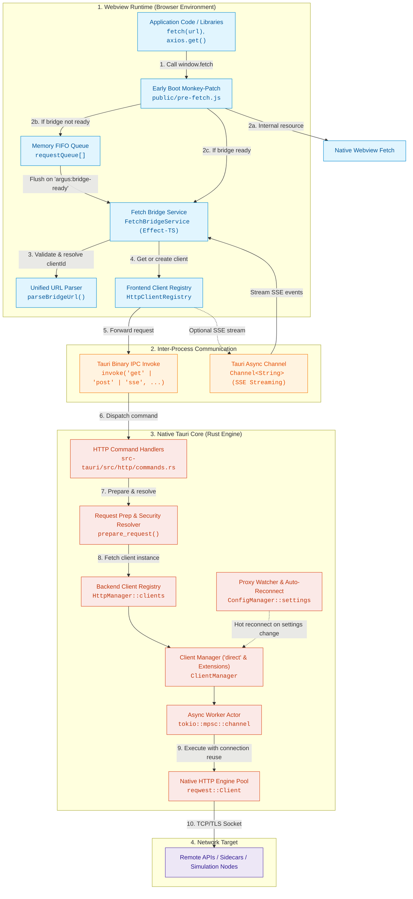
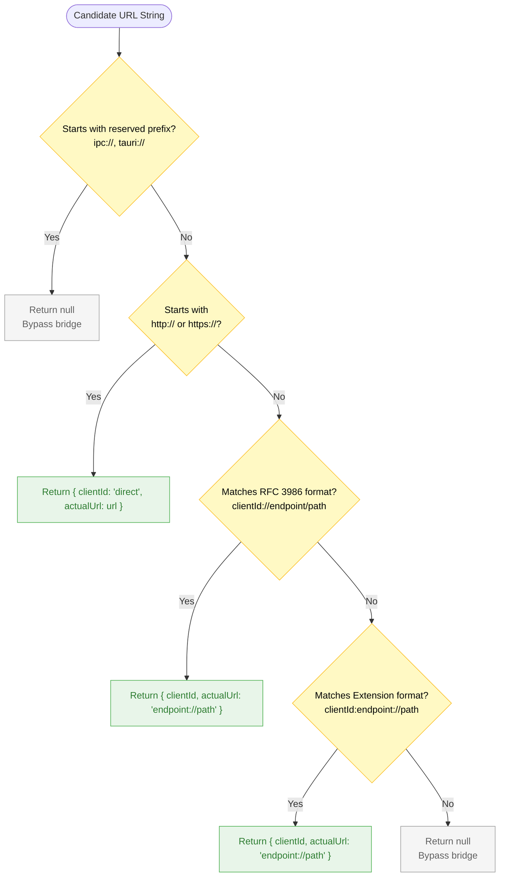
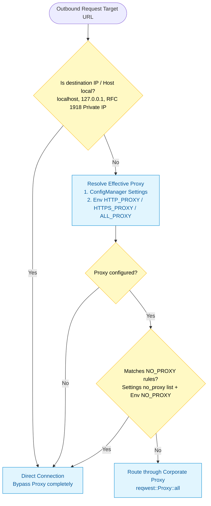
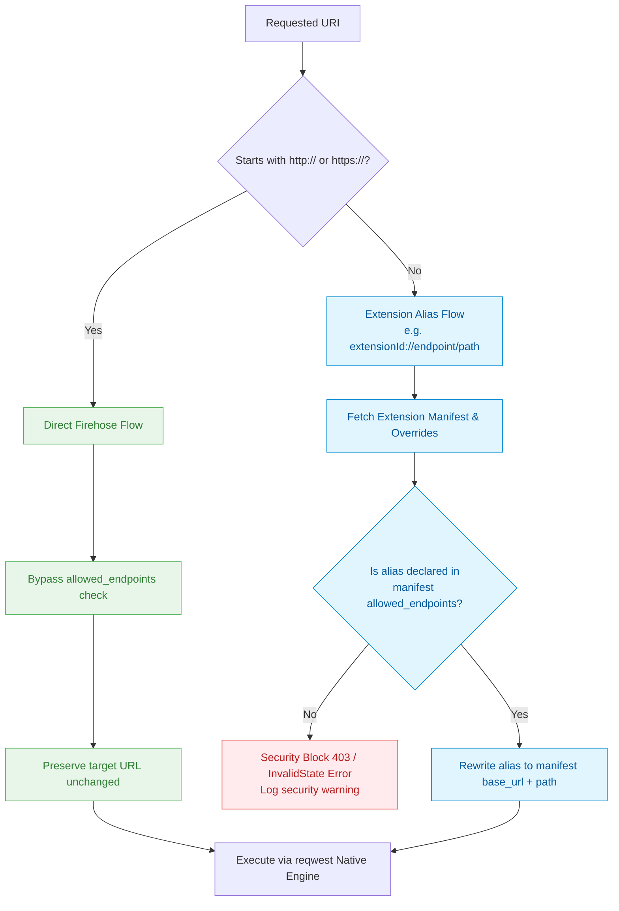
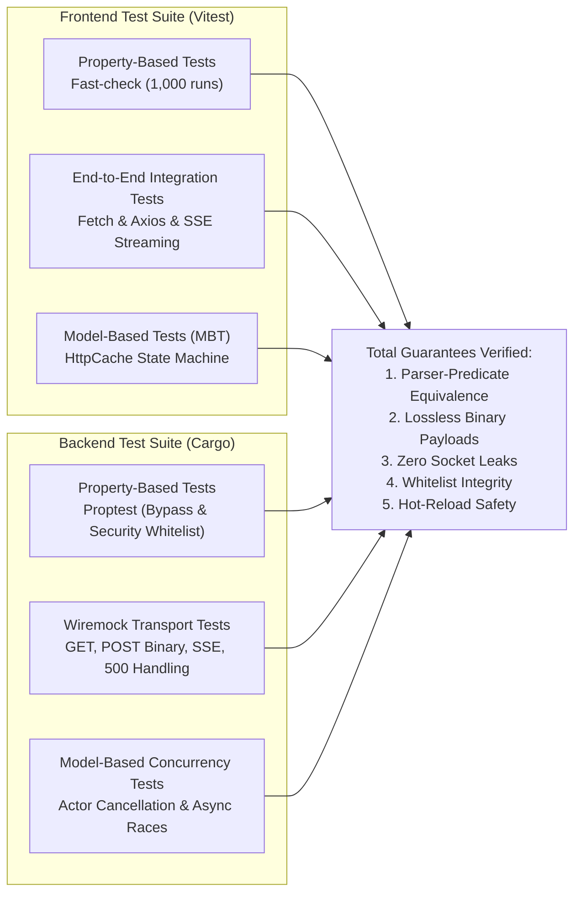

# Architecture Specification: Fetch

## 1. Executive Summary & Problem Statement

In a default Tauri architecture, the frontend runs inside an operating system Webview (WebKit on Linux/macOS, WebView2 on Windows). Standard browser security mechanisms block outbound network requests triggered via `window.fetch()`.

While the official `@tauri-apps/plugin-http` provides a bypass, it requires static registration of permitted endpoints upfront in application capabilities.

### Challenges in Argus
1. **Dynamic Endpoints at Runtime**: Argus interacts with dynamically discovered endpoints (microservices, simulation orchestration engines like Dynawo/GameMaster/Scada, local sidecars, and pluggable user extensions) whose hostnames and ports cannot be known at compile time.
2. **Transparent Developer Experience (DX)**: Third-party SDKs, npm packages (e.g., Axios), and standard frontend code must work transparently with vanilla `fetch(url, options)` without wrapping calls in custom proprietary SDK functions.
3. **Enterprise Environment Compliance**: All outbound HTTP traffic must respect corporate proxy settings (`HTTP_PROXY`, `HTTPS_PROXY`, `NO_PROXY`) configured in Argus settings and react to runtime configuration updates without requiring application restarts.

---

## 2. Global System Architecture

The solution uses a hybrid **Pre-Script Monkey-Patch + IPC Bridge + Native Actor Pool** architecture:



---

## 3. Detailed Component Interaction & End-to-End Flow

### 3.1 Sequence Diagram: Standard and SSE Requests

```mermaid
sequenceDiagram
    autonumber
    actor Caller as Frontend Caller (fetch / axios)
    participant Patch as pre-fetch.js
    participant Bridge as FetchBridgeService (TS)
    participant TSReg as HttpClientRegistry (TS)
    participant IPC as Tauri IPC Channel
    participant Rust as HttpManager (Rust)
    participant Sec as Security & Resolver (Rust)
    participant Actor as Client Actor & reqwest
    actor Server as Target HTTP Server

    Caller->>Patch: window.fetch(url, options)

    alt Local resource (ipc://, tauri://, /assets/...)
        Patch-->>Caller: originalFetch(url, options)
    else External URL (http://, https://, alias://)
        alt Bridge initialization in-flight
            Patch->>Patch: Push to requestQueue[]
            Note over Patch: Wait for 'argus:bridge-ready' event
        end
        Patch->>Bridge: bridgeInstance.execute(input, init)
        Bridge->>Bridge: parseBridgeUrl(url)
        Note over Bridge: URL matched: clientId = 'direct', actualUrl = url

        Bridge->>TSReg: getClient("direct")
        alt Not in TypeScript memory cache
            TSReg->>TSReg: Instantiate makeTauriHttpClient("direct")
            TSReg->>TSReg: Store in Ref<HashMap>
        end
        TSReg-->>Bridge: Active TauriHttpClient instance

        alt Standard Request (GET, POST, PUT, DELETE, ...)
            Bridge->>IPC: invoke(method, { clientId: "direct", reqId, endpoint, headers, body })
            IPC->>Rust: prepare_request(&app_handle, &http_manager, "direct", endpoint, headers)
            Rust->>Sec: verify_endpoint_access(manager, "direct", endpoint)
            Note over Sec: Direct http(s) detected: BYPASS whitelist check
            Rust->>Sec: resolve_endpoint(manager, "direct", endpoint, headers)
            Note over Sec: Direct http(s) detected: Return target URL as-is
            Rust->>Actor: Dispatch Cancellable Request
            Actor->>Server: HTTP TCP/TLS Request (Socket Pool + Corporate Proxy)
            Server-->>Actor: HTTP Response (Status, Headers, Stream/Bytes)
            Actor-->>IPC: Binary Frame: [Metadata 4-bytes len | JSON Metadata | Body Bytes]
            IPC-->>Bridge: ArrayBuffer
            Bridge-->>Caller: Standard W3C Response Object
        else Streaming SSE Request (Accept: text/event-stream)
            Bridge->>IPC: invoke("sse", { clientId: "direct", reqId, endpoint, headers, onEvent: Channel })
            IPC->>Rust: Start SSE Stream Actor
            Rust->>Server: HTTP GET (Accept: text/event-stream)
            loop Active Event Stream
                Server-->>Rust: Chunk / Event Line
                Rust-->>IPC: Channel.send(event_string)
                IPC-->>Bridge: Channel.onmessage(event_string)
                Bridge-->>Caller: ReadableStream Chunk Output
            end
            Server-->>Rust: Connection closed / [CLOSE]
            Rust-->>IPC: Channel.send("[CLOSE]")
            Bridge-->>Caller: Stream Close
        end
    end
```

---

## 4. Subsystem Deep-Dive

### 4.1 URL Parsing Single Source of Truth (`parseBridgeUrl`)

To prevent divergence between what the bridge intercepts and what the schema decodes, `parseBridgeUrl` in `src/services/http-client/fetch-service/interceptor.ts` acts as the single authority:



**Invariant Verification Guarantee**:
The property-based test suite (`tests/http-client/fetch/FetchBridge.property.test.ts`) formally proves across 1,000 arbitrary generated Unicode strings that:
$$\forall s \in \text{String},\quad \text{shouldInterceptUrl}(s) \iff (\text{parseBridgeUrl}(s) \neq \text{null})$$

---

### 4.2 Shared Client Lifecycle & Registry Architecture

Instantiating a new native HTTP client per request creates massive overhead (ephemeral port exhaustion, TLS handshakes on every call, inability to share HTTP/1.1 and HTTP/2 Keep-Alive pools). 

The system routes all direct web traffic through a dedicated registered singleton client named `"direct"`:

```mermaid
stateDiagram-v2
    [*] --> Unconfigured: App Launch

    state FrontendRegistry {
        [*] --> TSNotCached
        TSNotCached --> TSCached: First request intercepted
        TSCached --> TSCached: Subsequent requests (Ref lookup)
    }

    state BackendRegistry {
        Unconfigured --> Disconnected: HttpManager::get_or_resolve_client('direct')
        Disconnected --> Connected: Connect with ConfigManager proxy settings
        Connected --> Connected: Handle multiple parallel requests
        Connected --> Reconnecting: ProxyWatcher detects proxy/no_proxy settings update
        Reconnecting --> Connected: Reconnect active client with new proxy rules
    }
```

#### Registry Responsibilities

| Dimension | Frontend (`HttpClientRegistry`) | Backend (`HttpManager`) |
|---|---|---|
| **Storage Primitive** | `Ref<HashMap<string, HttpClient>>` (Effect-TS) | `RwLock<HashMap<String, Arc<ClientManager>>>` |
| **Instance Lifetime** | Application Session Lifetime | Application Session Lifetime |
| **Direct Client Provisioning** | Lazy: instantiated upon first `fetch("http(s)://")` | Lazy: auto-registered with empty whitelist when requested |
| **Keep-Alive & Connection Pooling** | Managed downstream by Tauri IPC | Managed by `reqwest::Client` connection pool |
| **Configuration Synchronization** | Stateless (delegates network options to Rust) | Dynamic: Listens to `ConfigManager` via `tokio::sync::watch` |

---

### 4.3 Proxy Resolution & Dynamic Reconfiguration

Corporate networks require seamless proxy routing, including strict exclusions for internal infrastructure:



---

## 5. Security Architecture & Boundary Model

While direct `http://` and `https://` URLs intentionally bypass static endpoint whitelisting to enable dynamic network interactions, Argus's internal security perimeter remains strictly enforced for extension modules:



---

## 6. Test Architecture & Quality Matrix

The architecture is covered by automated verification layers across both TypeScript and Rust test runners:



### Test Coverage Summary

| Test Domain | File Location | Scope & Assertions |
|---|---|---|
| **Property Equivalence** | `tests/http-client/fetch/FetchBridge.property.test.ts` | Proves `shouldInterceptUrl` $\equiv$ `parseBridgeUrl !== null`, binary body immutability (`Uint8Array`, `ArrayBuffer`, `FormData`, `URLSearchParams`). |
| **Fetch & Axios Integration** | `tests/http-client/fetch/FetchIntegration.test.ts` | Validates native `window.fetch()` and `axios` with standard `https://` URLs, Bearer tokens, query encoding, `AbortController` cancellation, and streaming SSE consumption. |
| **Mock Registry Architecture** | `tests/mocks/index.ts` & `tests/setup.ts` | Validates `ResettableMock` contract with centralized `resetAllMocks()` in `beforeEach()`. |
| **Rust Endpoint Security** | `src-tauri/src/http/tests/property.rs` | Proves `verify_endpoint_access` and `resolve_endpoint` bypass whitelist checks for `http(s)://` while continuing to block unauthorized alias access. |
| **WireMock Transport** | `src-tauri/src/http_client/tests/wiremock.rs` | Verifies real HTTP socket interactions over local wiremock servers (binary payloads, server errors, SSE event stream delivery). |
