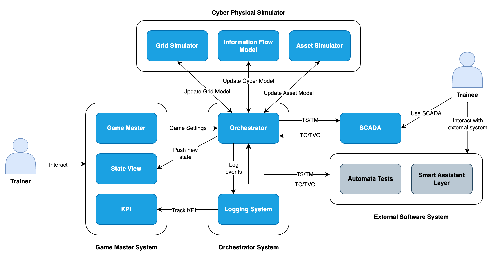
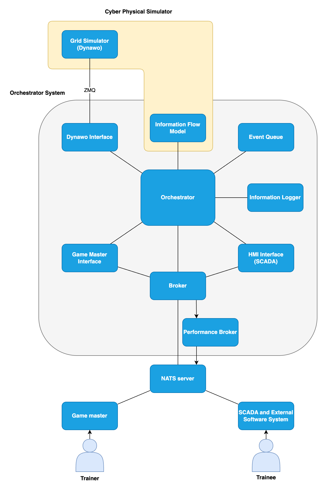
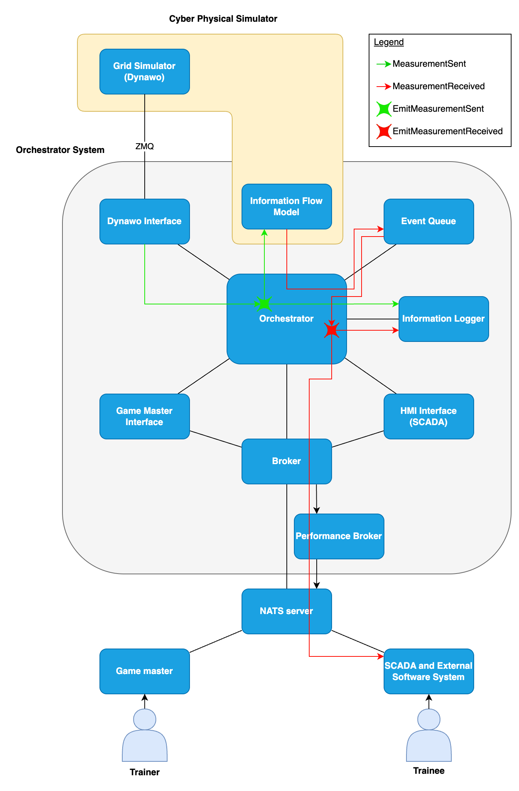
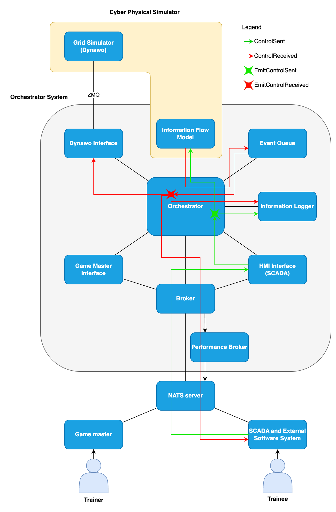
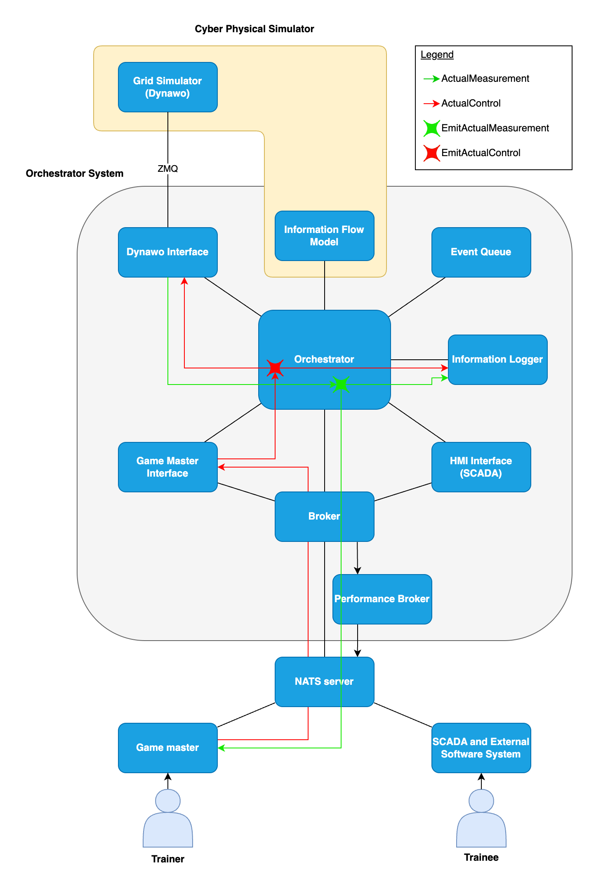

# TWIN-CR Architecture

This document provides a high-level overview of the TWIN-CR project architecture. It aims to help both newcomers and recurring contributors understand the project's structure, main components, and architectural decisions.

## Overview

The general architecture of the Digital Twin (DT) is shown in the figure below.



The DT consists in 4 main subsystems:

- The cyber-physical simulator that simulates the grid and its supporting cyber infrastructure. It is made of 3 simulators:
  - The grid simulator that simulates the evolution of all electrical variables of the grid (voltages, currents, powers).
  - The information flow models that simulates the delays, drops, and data corruptions occurring in the cyber layer.
  - The asset simulator that simulates grid elements which are not modelled in the grid simulator. This mostly include non-electrical variables, e.g. modelling of thermal sensors in transformers, alarms in substations, presence of an operator in a substation, etc.
- The Game master which has a complete and perfect view on the state of the cyber-physical simulator. It can also control most elements in the simulation (generator setpoints, breaker states, cyber elements, etc.)
- The SCADA which has an imperfect observability and controllability of the state of the cyber-physical simulator (only direct visibility on elements with sensors (and estimation of the remaining ones via the state estimation), and possible loss/corruption of information in the cyber layer).
- The orchestrator that manages the information exchanges between the different modules, handles time synchronisation, and ensures that the simulation runs in real-time.


## Code Map

The currently implemented modules are available in:

- Grid Simulator: The simulator used in this project is Dynawo which is available at this [link](https://github.com/dynawo/dynawo). Note that currently, only the experimental branch 3301_rt_dynawo_experiments can be interfaced with the orchestrator.
- SCADA and Game master front-end: The graphical interfaces for both the trainee view (SCADA) and trainer view (Game master) are both implemented in [`argus/`](../argus/) and their backends in [`argus-backends/`](../argus-backends/). A mock is also available in [`Orchestrator/hmi/hmi_nats.py`](../Orchestrator/hmi/hmi_nats.py)
- DSL server: [`gamemaster`](../gamemaster/)
- Orchestrator: [`Orchestrator/`](../Orchestrator/)
- Information flow model: [`Orchestrator/InformationFlowModel/`](../Orchestrator/InformationFlowModel/InformationFlowModel.h)
- Logging system: [`Orchestrator/Logger`](../Orchestrator/Logger/ClickHouseLogger.h)

The project structure looks like

```
TWIN-CR/
├── argus/                   # SCADA and Gamemaster frontend
├── argus-backends/          # SCADA and Gamemaster backends
├── docs/                    # Project documentation
│   ├── ARCHITECTURE.md      # High-level architecture documentation
│   ├── dsl_engine/          # DSL engine documentation
│   ├── game_master/         # Game master documentation
│   └── orchestrator/        # Orchestrator documentation and examples
│       └── examples/        # Simulation examples
├── Orchestrator/            # Main back-end
│   ├── AssetSimulator       # Simulation of assets not in Dynawo
│   ├── Broker               # Nats interface
│   ├── Credentials          # Handling of credentials for nats and clickhouse
│   ├── DynawoInterface      # Interface with physical simulator
│   ├── GameMasterInterface  # Interface with Game master state view (trainer view)
│   ├── HMIInterface         # Interface with SCADA (trainee view)
│   ├── InformationFlowModel # Cyber layer model
│   ├── Launcher             # Orchestrator launcher
│   ├── Logger               # Clickhouse-based logger
│   ├── Orchestrator         # Orchestrator event queue and time management
│   ├── ProcessLauncher      # Fork-based process launcher (used to launch Dynawo)
│   ├── Replay               # Replay of previous simulations
│   ├── ScenarioHandler      # Scenario interpreter
│   └── main.cpp
├── gamemaster/              # Game master back-end
│   ├── app/                 # Application entry points
│   └── core/                # Game master logic and routers
├── CHANGELOG                # Version history
├── LICENSE                  # License information
├── README.md                # Main README
├── requirements.txt         # Python dependencies
└── docker-compose.yaml      # Docker composition
```

## Detailed architecture

This section gives a more detailed view on the project architecture, focussing on the orchestrator system, and on the interfaces between all modules.

The detailed DT architecture is shown in the figure below (only the currently implemented modules are represented).

[](DetailedArchitecture.drawio.png)

### Information exchanges within the Orchestrator system

Information exchanges within the orchestrator system is mainly done through the emission of different types of events, and the subscription to such events. Indeed, any module of the orchestrator system can notify the orchestrator that it wants to be notified about events of type X by calling the function orchestrator.subscribeTo\<X\>(callback). Then, when another module emits the same type of event via orchestrator.emitX(event), the callback function will be called with the emitted event as argument.

The figures below show this principle is used to propagate the main types of events.

The first figure illustrates the propagation of measurements from the physical simulator (Dynawo) to the SCADA. At each Dynawo time step, the Dynawo interface receives through ZMQ (more info in the next [section](#information-exchanges-across-the-orchestrator-system-boundary)) updated values for all considered measurements. For each of them, it will ask the orchestrator to emit "MeasurementSent" events such that the other modules are made aware of this new information. The modules that subscribe to "MeasurementSent" events are the Information Logger (that will log this information to a file), and the Information Flow Model. The Information Flow Model will then evaluate how much this information will be delayed in the cyber layer, if it will be dropped or corrupted. In case it is not dropped, the module will generate a "MeasurementReceived" event and notify the other modules via orchestrator.emitMeasurementReceived(event, current_time + delay). Here, the event is delayed and is therefore not emitted directly. The orchestrator first stores this event in the event queue, and only emits it when the time reaches current_time + delay. On emission, the orchestrator then notifies the Information Logger (that will log this information to a file), and to the broker that will send this information to the SCADA via the NATS server.

Actually, for events that are emitted with a high frequency (most notably events of type MeasurementReceived and ActualMeasurement), the events are not sent directly from the Broker to the NATS server, but pass through the "Performance Broker". This second broker runs in a different thread, and formats the information in the adequate format (expected by the SCADA or Game master) before sending it. Intra-process communication between the Broker and the Performance Broker is performed through a SharedRingBuffer on a memory-mapped file.

The second figure illustrates the propagation of control signals from the SCADA to the physical simulator. When the trainee performs an action on the SCADA, the SCADA will send a message to the Broker via the NATS server. The Broker will forward this message to the HMI Interface that will read it and generate the associated "ControlSent" event. Then, as before, this event is emitted to be logged by the Information Logger, and processed by the Information Flow Model. The Information Flow Model then generates a "ControlReceived" events, which (after being delayed in the Event Queue) is sent to the Information Logger and the Dynawo interface.

The third figure illustrates the flow of information between the Dynawo Interface and the Game master. It is similar to the previous ones, except that since the Game Master has the "true" view (and control) on the state of the simulation, information do not need to go through the Information Flow Model nor the Event Queue (except for controls sent from the Game Master that are purposefully delayed (e.g. scenarios)). They are also logged by the Information Logger.

[](DetailedArchitecture_MeasurementSent.drawio.png)
[](DetailedArchitecture_ControlSent.drawio.png)
[](DetailedArchitecture_ActualValue.drawio.png)

Other types of events include:

- TimeUpdate: sent by the Dynawo Interface at each iteration, read by the Broker
- DynawoTimelineEvent: sent by the Dynawo Interface each time a timeline event occurs in Dynawo, read by the Broker (and maybe in the future by the asset simulator)
- DynawoConstraintEvent: same as TimelineEvent but for constraint events

### Information exchanges across the Orchestrator system boundary

Exchanges crossing the orchestrator system boundary are done either through ZMQ (for the communication between Dynawo and the Dynawo Interface) or through a NATS server (for all other exchanges). In both cases, topics are used to distinguish between different types of information exchanges.

#### Information exchanges with Dynawo

Communication between the Dynawo Interface and Dynawo is performed using ZMQ on 2 TCP sockets. The first socket is used to control the evolution of time in Dynawo and to send control signals. It is a REQ/REPLY socket (on port 5555), with the Dynawo Interface sending requests, and the Dynawo replying to those requests. Requests are in the form of:

- "" (empty string): signals Dynawo to go to its next time step (for this Dynawo must run in interactive mode and with `interactiveSettings tag set`)
- "stop": signals Dynawo to stop the simulation
- "ParameterSetName,parameter1,type1,value1,parameter2,type2,value2,..." where ParameterSetName is the name of a parameter set (or DYNModelUpdatable) to update, parameter1 is the name of the first parameter to update in the parameter set, type1 is its type (bool, int or double), and value1 is its new value.

When Dynawo received such a request, it can reply with either:

- "stop signal": indicated that the simulation was interrupted (no further requests will therefore be accepted)
- "simulation ended": indicating that the simulation reached t_max (no further requests will therefore be accepted)
- "trigger reply": indicating that the simulation will continue to the next time step
- "Action registered": indicating that the requested control action has been implemented

The second socket is a PUB/SUB socket (on port 5556) and is used by Dynawo to publish information on the following topics:

- "curves_names": ordered list of the names of the curves published by Dynawo. This list is only published once at the start of the simulation. All the remaining topics are published exactly once per time step (before Dynawo can reply to the request to go to the next time step).
- "curves_values": ordered list of the values of the curves (published in bytes as an array of doubles)
- "timeline": json containing all timeline events that occurred since the last time step (can be empty)
- "constraints": json containing all constraint events that occurred since the last time step (can be empty)

#### Information exchanges with the other systems

Information exchanges with external systems other than Dynawo are all made through the Broker and its connection to the NATS server. These also work on the principle of publications and subscriptions to different topics. The broker publishes on the following topics:

- "GameMaster.topic": publication of ActualMeasurement events (typically coming from Dynawo). 'topic' is a configurable topic, typically defined as the name of the substation from which the measurement comes from (allowing the game master to subscribe to updates from a given substation). Note that dots (".") will be replaced by underscores ("_") in 'topic' as dots are used as separators in NATS topics.
- "HMI.destination.topic": publication of MeasurementReceived events. 'destination' is the receiver of the MeasurementReceived event (as simulated in the information flow model). For example, 'destination' could be "CC" for messages that arrive at the control centre, and "automata1" for messages that arrive at the automata1. 'topic' is a configurable topic, typically defined as the name of the substation from which the measurement comes from (e.g. allowing the SCADA to subscribe to updates from a given substation).
- "time": time update.
- "Dynawo.Timeline": timeline events (same as in Dynawo but published one by one). These events are meant for the Game Master. In the future, the asset simulator will create similar events (but potentially delayed/dropped/corrupted in the Information Flow Model) to be sent to the SCADA.
- "Dynawo.Constraints": same as Dynawo.Timeline but for constraint events.
- "stop": topic used to signal the end of the simulation.

Note that, due to their high-frequency, publications on "GameMaster.topic" and "HMI.destination.topic" are made in the Performance Broker instead of the normal Broker.

And subscribes to the following topics:

- "GameMasterControl.>": for controls coming from the Game Master (implemented without (intentional) delay). The Broker replies with "OK" if the control could be implemented, else with an error description.
- "HMIControl.>": same, but for controls coming from the SCADA and automata (possibly delayed/dropped/corrupted in the information flow model). The Broker replies with "OK" if the control could be implemented, else with an error description.
