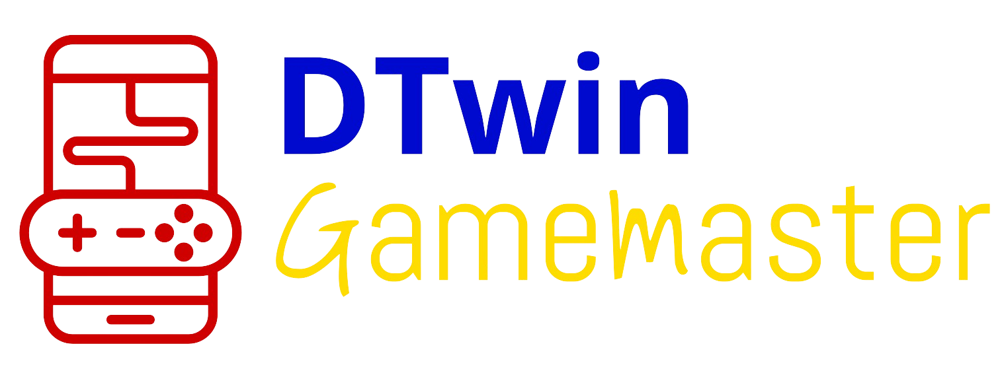

<div style="display: flex; justify-content: flex-start; align-items: center; gap: 20px;">
  
</div>

# DTwin GameMaster

> [!WARNING]
> **Legacy.** This is the Python game master, replaced by the C++ DSL engine in `Orchestrator/DSL/`. It is kept
> for rollback only, behind `WITH_LEGACY_DSL=true` and the `legacy_dsl` compose profile (both are needed, see
> `.env-example`).
>
> Everything below describes the old service, and neither its DSL nor its API matches what runs by default:
>
> - **API.** The current endpoints are documented by Swagger at
>   <http://localhost:8000/swagger/ui> while the stack is up (`DSL_SERVER_EXPOSED_PORT`, 8000 by default; the raw
>   spec is at `/api-docs/oas-3.0.0.json`)

[](https://www.python.org/downloads/release/python-3100/)
[](../../LICENSE)
[](./index.rst)
[](https://github.com/psf/black)
[](https://peps.python.org/pep-0257/)


> FastAPI control plane that ingests DSL scenarios, aggregates simulator signals, and streams IIDM commands to the Twin-CR orchestration stack.

[DSL-first scenario authoring] • [Deterministic power-system orchestration] • [REST + NATS integration]

## Table of Contents

- [Overview](#overview)
- [Features](#features)
- [Installation](#installation)
- [Quick Start](#quick-start)
- [Usage Examples](#usage-examples)
- [Documentation](#documentation)
  - [Building Documentation with Sphinx](#building-documentation-with-sphinx)
  - [API Documentation](#api-documentation)
- [Configuration](#configuration)
- [Testing](#testing)
- [Contributing](#contributing)
- [License](#license)
- [Changelog](#changelog)
- [Support](#support)

## Overview

DTwin GameMaster is the orchestration layer that sits between Twin-CR simulators, user control stations, and downstream orchestrators. It parses power-system scenarios authored in the DTwin DSL (ANTLR-based), persists events, and exposes organized FastAPI endpoints that coordinate training, simulator control, and live user commands. Each simulation step reconciles DSL schedules, control overrides, and telemetry-informed state so the orchestrator receives a single consistent payload.

This service is designed for researchers and operators who need deterministic, replayable power-system experiments without writing low-level IIDM commands by hand. By providing a DSL-driven interface, GameMaster lets domain experts encode interval laws, conditional triggers, and dependent events that remain traceable via Swagger and Sphinx docs. Compared with bespoke scripts, GameMaster adds reproducibility (ClickHouse-backed artefacts), collaborative HTTP APIs, and turnkey Docker Compose integration with the rest of the Twin-CR stack.

## Features

### Key Features

- **DSL-based simulation configuration:** Upload a DSL file to set duration, timestep, interval laws (currently `linear`), and event dependencies that the engine resolves per step.
- **Interval laws with gradual enforcement:** Interval actions may specify a `law` (e.g., `linear`) so setpoints progress smoothly at each simulation tick until the requested percentage is reached.
- **Event aggregation and normalization:** `/sim` endpoints collect DSL events, simulator control requests, and direct user overrides into a single `AggregateOutput` structure ready for IIDM publication.
- **Operational visibility:** `/user/controls`, `/user/status`, `/queue/list`, `/queue/{event_id}` (PUT), and `/queue/summary` expose real-time snapshots of pending actions, simulation health, and infrastructure readiness (including modifying or deleting pending DSL/trainer events).
- **ClickHouse object storage + NATS integration:** DSL artefacts, IIDM uploads, and cached network metadata live in a ClickHouse-backed object store, while generated commands travel over NATS via the GameMaster bridge services.
- **Organized endpoint groups:** Routers are grouped under `/trainer`, `/sim`, and `/user` prefixes to reflect persona responsibilities and ease access control.

### Use Cases

1. **Scenario training pipelines:** Upload IIDM + DSL artefacts, validate component references, and persist normalized events before launching a simulator.
2. **Closed-loop simulator control:** Step through large time-series experiments where `/sim/simulatorcontrol` merges DSL actions, trainer overrides, and user commands per timestamp.
3. **Operational what-if studies:** Operators submit instantaneous control commands via `/user/control`, track pending actions through `/user/controls`, and monitor service health with `/user/status` before executing simulator steps.

### Sequence Diagrams

- **IIDM command publishing per simulator tick:** See [command_publish_seq](assets/command_publish_seq.png) for the end-to-end flow from time advancement to NATS publication.
- **Command persistence, validation, and selection:** See [gamemaster_seq](assets/gamemaster_seq.png) for the lifecycle from DSL/user ingest through persistence, validation, and step selection.

## Installation

### Prerequisites

Before installing, ensure you have:

- Python 3.10 or higher
- `pip` and `virtualenv`
- Docker + Docker Compose (for containerized deployment)
- Access to ClickHouse and a NATS server

### Using pip (Recommended)

```bash
pip install "git+https://github.com/rte-france/Twin-CR.git#subdirectory=gamemaster"
```

> A PyPI package is not yet published; the Git-based install keeps you in sync with the `gamemaster` package inside this repository.

### From Source

```bash
# Clone the repository
git clone https://github.com/rte-france/Twin-CR.git
cd Twin-CR

# (Optional) checkout the dedicated GameMaster branch
git checkout gamemaster/dev

# Create and activate a virtual environment
python -m venv .venv
source .venv/bin/activate  # On Windows: .venv\Scripts\activate

# Install dependencies
pip install --upgrade pip
pip install -r requirements.txt

# Install in editable mode for local development
pip install -e gamemaster
```

Start the API with Uvicorn:

```bash
uvicorn gamemaster.app.main:app --reload --host 0.0.0.0 --port 8000
```

### Docker Installation

```bash
# Build and run only the GameMaster stack
docker compose up --build gamemaster clickhouse nats

# (Optional) launch the full Twin-CR environment
docker compose up --build
```

> The Compose file uses `envs/Dockerfile.gamemaster` and binds the repo into `/app` for rapid iteration. ClickHouse listens on `:8123`, and NATS exposes `4222/6222/8222` for client, clustering, and monitoring endpoints.

### Verify Installation

```bash
# Confirm the FastAPI app metadata
python - <<'PY'
from gamemaster.app.main import app
print(f"GameMaster {app.version}")
PY

# Hit the interactive docs once the server is running
curl http://127.0.0.1:8000/docs
```

### Troubleshooting Installation

**Issue:** Storage requests time out when uploading DSL/IIDM files.
**Solution:** Ensure ClickHouse is reachable on `CLICKHOUSE_HOST:CLICKHOUSE_PORT` (default `localhost:8123`) and that the `gamemaster.file_storage` table can be created. Logical buckets are defined by `GAMEMASTER_IIDM_BUCKET` and `GAMEMASTER_DSL_BUCKET`.

**Issue:** `NATS connection refused` in logs.
**Solution:** Start the bundled `nats` service (`docker compose up nats`) or point `NATS_URL` to an accessible server. Set `NATS_BRIDGE_ENABLED=false` if you only need HTTP endpoints locally.

## Quick Start

Get GameMaster running either with Docker Compose (all dependencies) or locally with dedicated ClickHouse and NATS containers.

### Option 1 – Docker Compose (recommended)

1. Copy `.env` with the ClickHouse/NATS settings you expect (`CLICKHOUSE_HOST`, `CLICKHOUSE_PORT`, `CLICKHOUSE_DATABASE`, `NATS_URL`, etc.).
2. Build and launch only the GameMaster stack plus its dependencies:
   ```bash
   docker compose up --build gamemaster clickhouse nats
   ```
3. Wait until the logs show `Application startup complete`. Visit `http://localhost:8000/docs` to confirm the FastAPI docs are available.
4. Upload DSL scenarios (e.g., `docs/orchestrator/examples/Nordic/Nordic.dsl`) via the `/trainer/init` endpoint and run your workflow.

### Option 2 – Local Uvicorn + Shared Services

1. Start ClickHouse and NATS (or reuse shared infrastructure):
   ```bash
   docker run --rm -p 8123:8123 -p 9000:9000 --name clickhouse \
     clickhouse/clickhouse-server:latest

   docker run --rm -p 4222:4222 -p 8222:8222 nats:latest -js
   ```
2. Export environment variables so GameMaster knows how to reach those services:
   ```bash
   export CLICKHOUSE_HOST=localhost
   export CLICKHOUSE_PORT=8123
   export CLICKHOUSE_DATABASE=gamemaster
   export GAMEMASTER_IIDM_BUCKET=iidm-files
   export GAMEMASTER_DSL_BUCKET=dsl-files
   export NATS_URL=nats://localhost:4222
   ```
3. Install dependencies and run Uvicorn:
   ```bash
   python -m venv .venv
   source .venv/bin/activate
   pip install -r requirements.txt
   uvicorn gamemaster.app.main:app --reload --host 0.0.0.0 --port 8000
   ```
4. GameMaster is now reachable on `http://localhost:8000`; proceed with the sample workflow below.

### Sample Workflow (HTTP)

```bash
# Run the API with autoreload
uvicorn gamemaster.app.main:app --reload

# Inspect available commands
uvicorn --help

# Common workflow
uvicorn gamemaster.app.main:app --port 8000 &
curl -F 'dsl_file=@docs/orchestrator/examples/Nordic/Nordic.dsl' \
     -F 'simulationName=nordic-demo' \
     "http://localhost:8000/trainer/init"
curl -X POST "http://localhost:8000/trainer/dsl_command" \
  -H "Content-Type: text/plain" \
  --data-binary $'event load increase id=LOAD1 percentage=10 at=5'
curl -X PUT "http://localhost:8000/user/control" \
  -H "Content-Type: application/json" \
  -d '{"control_type": "switch", "action": "open", "id": "CB1", "timestamp": 5.0}'
curl -X POST "http://localhost:8000/sim/simulatorcontrol" \
  -H "Content-Type: application/json" \
  -d '{"current_time": 5.0}'
curl "http://localhost:8000/user/controls"
curl "http://localhost:8000/user/status"
```


## Usage Examples

### Trainer & DSL Management

```bash
# Initialize a simulation (uploads IIDM metadata + DSL script)
curl -X POST "http://localhost:8000/trainer/init" \
  -F 'iidm_file=@data/network.iidm' \
  -F 'dsl_file=@dsl/demo.dsl' \
  -F 'simulationName=summer-grid'

# Inject ad-hoc trainer overrides via DSL snippets
curl -X POST "http://localhost:8000/trainer/dsl_command" \
  -H "Content-Type: text/plain" \
  --data-binary $'at 1 seconds, change network characteristics link from "CC" to "substation_1", drop fixed true tagged "CC_to_substation_1";
'

# Explore stored artefacts
curl "http://localhost:8000/trainer/dsl/simulations"
curl "http://localhost:8000/trainer/dsl/summer-grid"
curl "http://localhost:8000/trainer/iidm"
```

### Simulator Control Endpoints

```bash
# Aggregate DSL + trainer + user actions for the next timestep
curl -X POST "http://localhost:8000/sim/simulatorcontrol" \
  -H "Content-Type: application/json" \
  -d '{"current_time": 300}'

# Request low-level IIDM commands (matches GameMasterControl.DSL schema)
curl -X POST "http://localhost:8000/sim/simulatorcontrol_v2" \
  -H "Content-Type: application/json" \
  -d '{"current_time": 300}'
```

### IIDM Artefacts

```bash
curl -X POST "http://localhost:8000/iidm/upload" \
  -F 'iidm_file=@data/network.iidm'

curl "http://localhost:8000/iidm/properties/<IIDM_FILE_ID>"
```

### User Controls & Status

```bash
# Single-device control
curl -X PUT "http://localhost:8000/user/control" \
  -H "Content-Type: application/json" \
  -d '{"control_type": "switch", "action": "open", "id": "CB1", "timestamp": 305.0}'

# Clustered control (targets list or dynamic filter)
curl -X PUT "http://localhost:8000/user/cluster_control" \
  -H "Content-Type: application/json" \
  -d '{
        "control_type": "load",
        "action": "decrease",
        "target": ["LOAD1","LOAD2","LOAD3"],
        "timestamp": 305.0,
        "value": 10.0
      }'

# Inspect queued controls and overall status
curl "http://localhost:8000/user/controls"
curl "http://localhost:8000/user/status"
```

### Event Queue & Atomic DSL

```bash
curl "http://localhost:8000/queue/list?status=pending&limit=20"
curl "http://localhost:8000/queue/summary"
curl -X PUT "http://localhost:8000/queue/{event_id}" -H "Content-Type: text/plain" --data 'at 120 seconds, decrease load "ID" by 10%;'
curl -X DELETE "http://localhost:8000/queue/{event_id}"
curl -X POST "http://localhost:8000/atomic/rt-user_control_dsl" \
  -H "Content-Type: text/plain" \
  --data-binary $'increase load ["LOAD   2", "LOAD   3", "LOAD   4"] by 15%;'
```

### Postman Collection

Import the ready-to-run Postman collection at
`docs/game_master/examples/Simulation API Collection.postman_collection.json`. It mirrors the
workflow above (trainer init, DSL command injection, simulator control, user/queue/status
inspection). Set the `baseUrl` variable to your GameMaster instance (e.g., `http://localhost:8000`)
and Postman will replay the sample requests without manual edits.

### Interactive API Documentation

- Swagger UI: `http://127.0.0.1:8000/docs`
- ReDoc: `http://127.0.0.1:8000/redoc`

## Documentation

The `docs/game_master` directory contains the full Sphinx project, complete with architecture diagrams, router walkthroughs, and autodoc-backed API references (`routers.rst`, `domain.rst`, `services.rst`, `utilities.rst`, and `api_reference.rst`). The authoritative DSL description and class diagrams live alongside the grammar under `../dsl_engine/`—see `DSL_Description.pdf` for the latest language spec and `PowerEventDSL.g4` for the ANTLR source.

### Building Documentation with Sphinx

```bash
# Install documentation tooling
python -m pip install --upgrade sphinx sphinx-autobuild sphinx-rtd-theme

# (Optional) regenerate autodoc stubs to keep API docs current
sphinx-apidoc -o docs/game_master/api_reference gamemaster

# Build HTML output
sphinx-build -b html docs/game_master docs/_build/game_master

# Live-reload while editing
sphinx-autobuild docs/game_master docs/_build/game_master
```
To view the docs: Open the landing page (docs/_build/game_master/index.html) in your browser.

- `conf.py` already enables the Read the Docs theme; override with `SPHINX_HTML_THEME` as needed.
- Do not commit files in `docs/_build`; let CI or Read the Docs build from sources.
- Publishing to Read the Docs only requires pointing RTD at `docs/game_master/conf.py`.

### API Documentation

1. Document new routers in `docs/game_master/routers.rst` using `.. automodule:: gamemaster.core.routers.<module>` and enable `:members:`.
2. Extend `domain.rst`, `services.rst`, and `utilities.rst` whenever you add controllers, background services, or helper modules so autodoc stays exhaustive.
3. Reference the JSON command schema stored at `payload/schema/schema_v2.json` when describing payloads such as `GameMasterControl.DSL`. A typical entry is:
   ```json
   {
     "command": "iidm_command",
     "t_start_from_now": 0,
     "iidm_id": "LOAD   2",
     "attribute": "P",
     "value": 1.2
   }
   ```
4. Reference the updated DSL description (`../dsl_engine/DSL_Description.pdf`) and ANTLR grammar (`../dsl_engine/PowerEventDSL.g4`) whenever documenting new keywords or interval laws.

## Configuration

Environment variables live in `.env` (sample values shown below):

| Variable | Purpose | Default |
| --- | --- | --- |
| `LOG_LEVEL` | FastAPI/Uvicorn logging level | `INFO` |
| `CLICKHOUSE_HOST` / `CLICKHOUSE_PORT` | ClickHouse address for artefacts | `localhost` / `8123` |
| `CLICKHOUSE_DATABASE` | Database used for the object store table | `gamemaster` |
| `CLICKHOUSE_USERNAME` / `CLICKHOUSE_PASSWORD` | Optional ClickHouse credentials | `` |
| `GAMEMASTER_IIDM_BUCKET` | Logical IIDM upload bucket | `iidm-files` |
| `GAMEMASTER_DSL_BUCKET` | Logical DSL artefact bucket | `dsl-files` |
| `NATS_BRIDGE_ENABLED` | Toggle NATS publishing | `true` |
| `NATS_URL` | NATS endpoint used by the bridge | `nats://localhost:4222` |
| `TZ` | Time zone for containers | `Europe/Paris` |

Additional notes:

- Ensure ClickHouse is reachable before calling `/trainer/init`; otherwise uploads fail.
- A local SQLite event store is created automatically inside `gamemaster/core/domain`.
- `.env` is loaded by Docker Compose; update it when running via `uvicorn`.


## Contributing

We welcome enhancements and bug fixes!

1. Read `CONTRIBUTING.md` for coding standards, branching strategy, and review expectations.
2. Create a feature branch from `gamemaster/dev`.
3. Format code with `black` and ensure `pytest` passes.
4. Update the Sphinx docs (`docs/game_master`) and DSL examples when introducing new behaviors.
5. Open a pull request with a concise description, screenshots (if relevant), and testing evidence.

## License

This project is licensed under the [Mozilla Public License 2.0](../../LICENSE).

## Support

- **Primary contact:** Sreejith Pananchickal Sajeev, M.Sc. — <sreejith.pananchickal@eonerc.rwth-aachen.de>
- [Institute for Automation of Complex Power Systems (ACS)](http://www.acs.eonerc.rwth-aachen.de)
- [E.ON Energy Research Center (E.ON ERC)](http://www.eonerc.rwth-aachen.de)
- [RWTH Aachen University, Germany](http://www.rwth-aachen.de)


## Function DSL Extension

GameMaster also supports reusable DSL functions in trainer-managed scenarios. Functions let you package several relative-timed actions behind a named call and reuse them from the base script or from later trainer DSL snippets.

### Supported Syntax

```dsl
func stagedLoadBoost(target, amount) {
  at +0 seconds, increase load target by amount% tagged "boost_start";
  at +5 seconds, decrease load target by amount% tagged "boost_end";
}

stagedLoadBoost("_LOAD___2_EC", 5);
at 35 seconds, stagedLoadBoost("_LOAD___3_EC", 3);
at 42 seconds, checkAndApply(stagedLoadBoost(target: "_LOAD___4_EC", amount: 2));
```

### Function Rules

- Function-body `at +...` timestamps are relative to the invocation time.
- Calls support positional and named arguments.
- Functions may contain nested function calls.
- Functions may be invoked directly or wrapped in `checkAndApply(...)`.
- `checkAndApply(...)` is all-or-nothing: if one expanded action fails validation, the whole invocation is rejected.
- Function calls can be used as bare statements or under `at`, `when`, and `after` triggers.

### Example Files

- Full Nordic example with switch actions, IFM/network actions, regex clusters, intervals, and functions:
  `docs/orchestrator/examples/Nordic/Nordic_functions.dsl`
- Compact GameMaster example with appended function samples:
  `docs/game_master/examples/sim.dsl`
