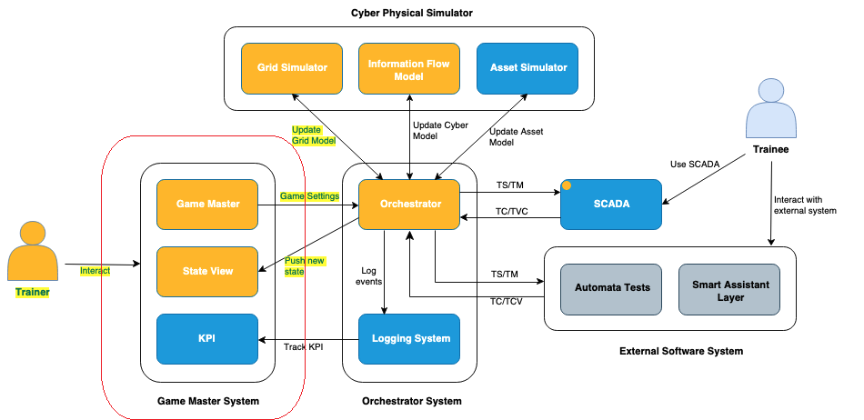
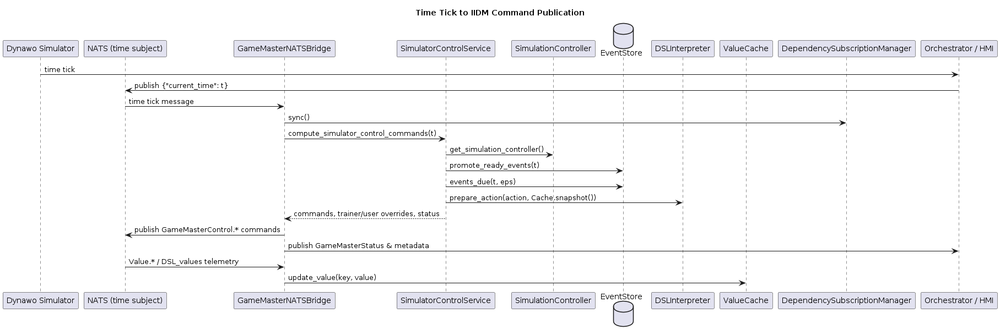
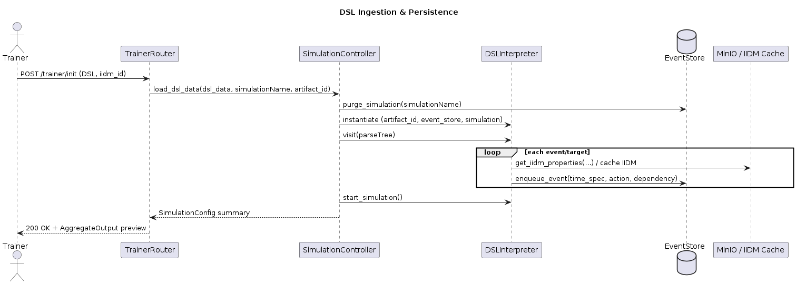

Overview
========

GameMaster is a FastAPI-based orchestration layer that ingests DSL scripts,
persists simulator events, coordinates user controls, and publishes IIDM
commands to downstream orchestrators over NATS. This page provides a guided
tour of the moving parts so you can navigate the rest of the documentation.

GameMaster in Twin-CR Ecosystem
------------------------------

Control Plane Responsibilities
------------------------------

Training / DSL Ingestion
    The ``/trainer`` router accepts IIDM uploads and DSL scripts, validates
    component references, and stores structured events in SQLite.

Simulation Control
    The ``/sim`` router exposes endpoints that advance the simulator timeline,
    combining DSL actions, trainer overrides, and user controls into a single
    response payload.

Background Services
    Components under ``gamemaster.core.services`` manage NATS connectivity,
    measurement subscription hygiene, and command publication to the
    orchestrator.

Event Flow
----------

1. **DSL upload & validation** – IIDM metadata is cached in the ClickHouse
   object store, the DSL interpreter parses the script, and the resulting
   events are persisted.
2. **Step resolution** – When the simulator requests the next step, GameMaster
   fetches due events, merges them with user controls, and returns
   ``AggregateOutput`` records.
3. **Command generation** – For v2 endpoints and the NATS bridge, actions are
   converted into IIDM commands and published to orchestrators. Measurement
   subscriptions are updated whenever DSL dependencies reference new keys.

Key Packages
------------

``gamemaster.core.routers``
    FastAPI routers and route handlers.

``gamemaster.core.domain``
    Simulation controllers, user control managers, event stores, and
    Pydantic entities.

``gamemaster.core.services``
    NATS bridge, simulator control command generation, dependency subscription
    management, and other background tasks.

``gamemaster.core.utils.DSLEngine``
    ANTLR grammar, visitor mixins, DSL interpreters, and persistence helpers.

Data Stores & Caches
--------------------

EventStore
    Lightweight SQLite database (local file or in-memory) that persists point,
    interval, and condition events. Supports idempotency, dependency tracking,
    and status transitions.

ClickHouse Object Store
    Stores IIDM uploads, cached ``network_data.json`` files, and DSL artefacts
    using logical bucket names.

Value Cache
    In-process dictionary storing the latest measurement values used when
    resolving absolute setpoints for DSL actions.

Global Clock
    ``gamemaster.core.utils.clock`` ensures the simulation time never regresses
    even when multiple services interact with the same simulation name.

Sequence Diagrams
-----------------

Command Publication & Time Tick
~~~~~~~~~~~~~~~~~~~~~~~~~~~~~~~

   

   Sequence diagram showing how time ticks from the orchestrator trigger DSL
   aggregation, IIDM command generation, and publication over NATS.

DSL Ingestion & Event Persistence
~~~~~~~~~~~~~~~~~~~~~~~~~~~~~~~~~

   

   Sequence diagram illustrating how uploaded DSL scripts are validated,
   parsed, and persisted into the EventStore.
