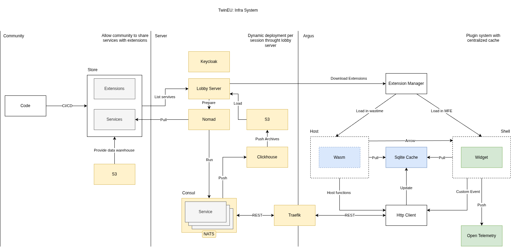

# TwinEU Infrastructure Architecture

This document is a technical overview of the internals of the TwinEU distributed infrastructure. It includes the high-level design, system boundaries, and the motivation behind core design decisions.

## Problem Statement

TwinEU needed a robust, multi-session prototyping infrastructure. The system must be capable of scheduling, deploying, and interconnecting complex software components dynamically, while maintaining strict isolation between user sessions.

The infrastructure must solve several core challenges:
* Provide on-demand, isolated environments (sessions) for users.
* Enforce strict security with zero static secrets.
* Ensure high availability and dynamic service discovery.
* Handle long-running orchestrations reliably in the face of component failures.

## Overview

TwinEU is designed as a distributed system orchestrated by HashiCorp Nomad. All human access to the platform services is unified through a single entrypoint (e.g., https://portal.<base_domain>).

Traffic is terminated and routed dynamically by an edge proxy, authenticated centrally, and executed on a cluster of nodes.

```
                            Browser
                               │
                 https://portal.<base_domain>
                               │
                               ▼
                       ┌───────────────┐
                       │    Traefik    │ :80 / :443
                       └───────┬───────┘
                               │
             ┌─────────────────┼─────────────────┐
             ▼                 ▼                 ▼
      [ Portal Hub ]     [ Keycloak ]      [ Nomad / Consul ]
```

The underlying infrastructure relies on a clear separation of concerns: 
- Nomad schedules the workloads
- Consul manages the network mesh and service discovery
- Vault acts as the root of trust
- Lobby Server acts as the gateway for session lifecycle management

Here is the complete schema of the TwinEU infrastructure:



## Design Decisions

### 1. "Zero Secrets in Git"
This infrastructure enforces a strict invariant: No plaintext application passwords, database credentials, or static certificates are ever stored or committed to version control.

Security is treated as a foundational primitive, not an afterthought:
- HashiCorp Vault (KV-v2): Application passwords live exclusively inside Vault's encrypted storage.
- Dynamic Injection: Nomad job templates dynamically inject secrets directly into memory (tmpfs) at container launch. The secrets never touch the disk.
- Automated Internal mTLS: Inter-service encryption uses Vault's PKI engine. Certificates are generated on the fly before container execution, eliminating manual rotation.

```
[ Git Repository ]                       [ Target Host / Cluster ]
        │                                          │
        │ 1. Declarative templates (no secrets)    │
        ├───────────────────────────────────────>  │
                                                   ▼
                                            [ Nomad Server ]
                                                   │
                                                   │ 2. Authenticates & requests ephemeral token
                                                   ▼
                                          [ HashiCorp Vault ]
                                                   │
                          ┌────────────────────────┴────────────────────────┐
                          ▼                                                 ▼
             [ KV-v2 Engine (secret/) ]                            [ PKI Engine (pki/) ]
             Encrypted passwords & keys                            Internal Root CA generates
                                                                   dynamic mTLS certificates
                          │                                                 │
                          └────────────────────────┬────────────────────────┘
                                                   │ 3. Secrets rendered directly into memory
                                                   ▼
                                         [ Container Workloads ]
```

### 2. Durable Session Lifecycles (Temporal)
*Note: Currently Experimental*

Deploying a session is a complex distributed transaction. To handle this, TwinEU explores using Temporal as its workflow execution engine. Temporal guarantees "Durable Execution".

If a component fails in the middle of a session deployment, Temporal automatically handles retries, maintains the workflow state in a database, and ensures no data is lost. This decouples the Lobby from the execution logic, allowing workflows like: *“If no user connects to the session for 30 minutes, gracefully tear down the infrastructure and notify the gamemaster.”*

### 3. Identity and Access Management (Keycloak)

Keycloak serves as the central Identity and Access Management (IAM) provider for the TwinEU platform, seamlessly integrated behind the Traefik edge proxy.

* **Centralized Authentication:** It acts as the sole gatekeeper, securing the Unified Portal and underlying administrative services via OIDC/OAuth2 protocols.
* **Automated Bootstrapping:** On its first boot, Keycloak automatically imports the `twineu` realm definition (clients, roles, scopes) from a declarative template.
* **State Persistence:** While the Keycloak application containers are ephemeral, all user data, sessions, and realm configurations are persisted on an underlying PostgreSQL database volume.
* **Zero-Secret Injection:** Initial admin credentials and database connection strings are never hardcoded. They are injected dynamically into Keycloak's memory from Vault at runtime.
* **Credential Rotation Lifecycle:** Because Keycloak only consumes bootstrap credentials upon its first initialization against an empty database, rotating the admin password requires a deliberate two-step operational process: updating the live credential directly within Keycloak's state, and subsequently synchronizing the new value in Vault to maintain it as the single source of truth for audits.

## Codemap

A map of the major components and where they fit logically within the system. 

*Note: Do not rely on hardcoded paths, use symbol search in your IDE to navigate.*

### Control Plane
- Nomad: The UNIX-philosophy task orchestrator. It reads declarative HCL files and schedules tasks across the cluster. It embeds an HTTP server to drive orchestration programmatically.
- Consul: The central coordinator. Manages Service Discovery, Service Mesh, and Health Checks.
- CNI: Handles bridge networking and IP allocation to ensure network isolation between container allocations.

### Security
- Traefik: Edge router. Integrates natively with Consul to dynamically route traffic without requiring restarts.
- Vault: The root of trust for PKI and static secrets.
- Keycloak: The sole source of truth for Identity and Access Management (IAM).
- dnsmasq: Provides dynamic wildcard DNS resolution (*.twin.local or *.twin.eu) without host file modifications.

### Session Logic
- Lobby: The custom Go/Python entrypoint for TwinEU. Exposes the API to start, stop, and manage sessions. Consumes CUE artifacts to validate user intent.
- Temporal: Orchestrates the long-running workflows defined by the Lobby.

### Persistence & Storage
- Garage S3: Distributed object storage for raw assets and bottomless SQLite backups.=
- PostgreSQL: The backing store for Keycloak state.
- ClickHouse: Time-series database for hot-archiving and telemetry.


## Project Structure

The physical layout of the codebase reflects the architectural boundaries.
```
.
├── docs/: In-depth operational guides (deployment, troubleshooting).
├── environments/
│   ├── dev/            # Local dev inventories and group_vars
│   └── opf/            # Production inventories and group_vars
├── roles/
│   ├── base/           # Base system configuration
│   ├── cni/            # CNI plugins for Nomad
│   ├── docker/         # Docker engine configuration
│   ├── garage/         # Garage S3 distributed storage
│   ├── hashicorp/      # Nomad, Consul, Vault, Traefik
│   ├── homepage/       # Unified infra entrypoint dashboard
│   ├── keycloak/       # Keycloak IAM service
│   ├── registry/       # Docker registry & Web UI
│   └── temporal/       # Temporal workflow server & UI
├── site.yml            # Main playbook entrypoint
├── Makefile            # CLI shortcut targets
└── .vault_pass.txt     # Vault encryption secret (git-ignored)
```
